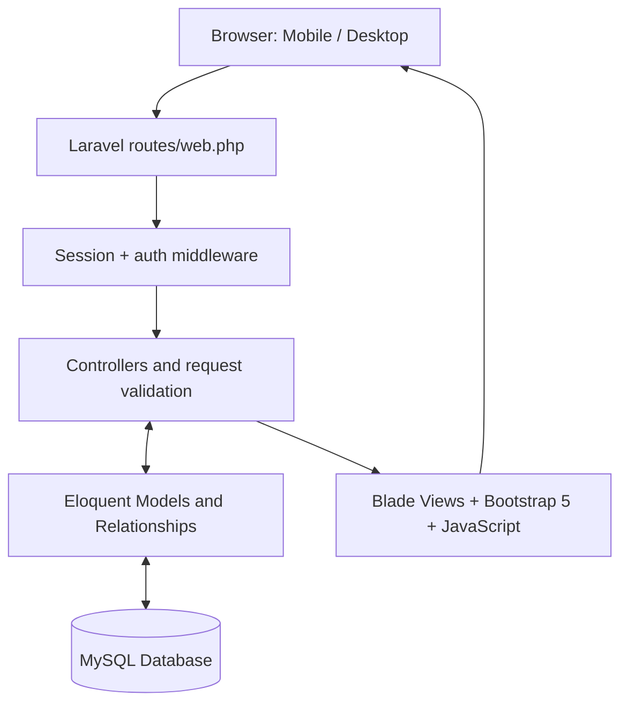

# TEMARA — Architecture

> Technical reference for the approved TEMARA Web MVP. This document records the agreed architecture and implementation constraints. It is not a replacement for the functional requirements in [`PRD.md`](PRD.md).

## 1. Architecture Decision Summary

| Area | Decision |
|---|---|
| Application style | Laravel monolith (single repository/application) |
| Backend | Laravel 13 / PHP 8.5 |
| Presentation | Laravel Blade |
| CSS | Bootstrap 5 |
| Client-side behavior | Vanilla JavaScript where needed |
| Database | MySQL / InnoDB |
| ORM | Eloquent |
| Authentication | Session-based Laravel authentication |
| Routing | `routes/web.php` |
| Version control | GitHub; `main`, `dev`, and `feature/*` branches |

The MVP does **not** use React, Next.js, Node.js/Express, a separate REST API backend, or a separate frontend repository.

## 2. High-Level Application Architecture



Request flow:

1. Browser sends a request to a route in `routes/web.php`.
2. Public or authenticated middleware determines access.
3. Controller validates input and coordinates application behavior.
4. Eloquent models perform database operations and traverse relationships.
5. Controller returns a Blade view with the data required by the page.
6. Blade renders HTML; Bootstrap 5 provides responsive UI components and JavaScript handles limited client-side interactions.

Forms use Laravel CSRF protection and method spoofing for `PUT`, `PATCH`, and `DELETE` where required.

## 3. Application Boundaries

### Included in MVP

- Session authentication (register/login/logout).
- One elder profile per user.
- Dashboard summary.
- Medication schedule management and daily taken state.
- Doctor control schedule management and completion state.
- Seeded caregiver directory and detail.
- Booking request creation, history, cancellation and completion.

### Excluded / Deferred

- Separate REST API or SPA architecture.
- Admin or caregiver accounts/dashboards.
- Real-time caregiver availability or provider confirmation.
- Online payment, pricing and financial transactions.
- Chat, video calls, push notifications, browser alarms and automated email.
- Prescription/document upload.
- Multiple elders per user.
- P1 doctor notes, health report and education articles until P0 is stable.

## 4. Core Data Model

### 4.1 Entity Relationship Diagram

```mermaid
erDiagram
    USERS ||--o| ELDERS : manages
    USERS ||--o{ BOOKINGS : creates
    ELDERS ||--o{ BOOKINGS : associated_with
    ELDERS ||--o{ CONTROLS : has
    ELDERS ||--o{ MEDICATIONS : has
    CAREGIVERS ||--o{ BOOKINGS : selected_for

    USERS {
        bigint id PK
        string name
        string email UK
        string password
    }
    ELDERS {
        bigint id PK
        bigint user_id FK_UK
        string name
        tinyint age
        text health_condition
        string photo
    }
    CAREGIVERS {
        bigint id PK
        string name
        string service_type
        string experience
        text languages
        string service_area
        string certification
        string photo
        decimal rating
        int review_count
    }
    BOOKINGS {
        bigint id PK
        bigint user_id FK
        bigint elder_id FK
        bigint caregiver_id FK
        date booking_date
        time start_time
        time end_time
        string status
    }
    CONTROLS {
        bigint id PK
        bigint elder_id FK
        date control_date
        string place
        boolean is_done
    }
    MEDICATIONS {
        bigint id PK
        bigint elder_id FK
        string name
        string dosage
        string period
        time time
        date last_taken_date
    }
```

### 4.2 Table Responsibilities

| Table | Responsibility | Ownership / relationship |
|---|---|---|
| `users` | Family account and authentication identity | Parent of `elders` and `bookings` |
| `elders` | One elder profile managed by one account | `user_id` is unique; parent of controls, medications and elder-related bookings |
| `caregivers` | Static caregiver catalogue for demo | Seeded data; parent of bookings |
| `bookings` | User's caregiver request and status history | Belongs to user, elder and caregiver |
| `controls` | Doctor control schedules | Belongs to elder |
| `medications` | One row per medicine-taking schedule | Belongs to elder |

### 4.3 Implementation Naming Notes

- The PRD's conceptual elder condition field is implemented in the approved migration as `health_condition`; the migration also includes nullable `photo` for the elder profile UI. Use `health_condition` consistently in Eloquent, validation, Controller and Blade.
- Booking database statuses are `submitted`, `completed`, and `cancelled`. The user-facing Indonesian labels are **Diajukan**, **Selesai**, and **Dibatalkan**.
- Medication `period` is stored as a string. The application must validate only `Pagi`, `Siang`, `Sore`, or `Malam`.
- The medication `last_taken_date` tracks the daily status for each schedule. A schedule is marked taken only when the stored date equals the current application date.

## 5. Eloquent Relationship Contract

| Model | Relationship | Related model |
|---|---|---|
| `User` | `hasOne` | `Elder` |
| `User` | `hasMany` | `Booking` |
| `Elder` | `belongsTo` | `User` |
| `Elder` | `hasMany` | `Booking` |
| `Elder` | `hasMany` | `Control` |
| `Elder` | `hasMany` | `Medication` |
| `Caregiver` | `hasMany` | `Booking` |
| `Booking` | `belongsTo` | `User`, `Elder`, `Caregiver` |
| `Control` | `belongsTo` | `Elder` |
| `Medication` | `belongsTo` | `Elder` |

Existing Laravel `User` model should be extended with relationships without replacing unrelated framework behavior.

## 6. Data Ownership and Authorization

This is a core application invariant, not merely a UI rule.

1. The authenticated user is the source of ownership; never trust a submitted `user_id` as proof of ownership.
2. Resolve the elder through the authenticated user relationship (for example, the current user's `elder` relationship).
3. Read, update, delete, complete, or mark-taken operations must be scoped through the current user's elder and/or booking relationship.
4. For bookings, ensure the selected `elder_id` belongs to the authenticated `user_id`; both values exist as foreign keys but a normal pair of independent foreign keys does not enforce that they belong together.
5. Test with at least two separate accounts to ensure private data cannot cross account boundaries.

### Database deletion rules from the reviewed migrations

- Deleting a user cascades to their elder and user-owned bookings.
- Deleting an elder cascades to related bookings, controls, and medications.
- Deleting a caregiver is restricted while booking references exist, protecting booking history.

## 7. Booking Business Rules

- A booking is a **request record**, not an availability confirmation.
- Caregiver choices are sourced from seeded database records.
- Booking date cannot be in the past.
- `end_time` must be later than `start_time`.
- Allowed internal statuses: `submitted`, `completed`, `cancelled`.
- A user may cancel a request that is not completed.
- A user may mark a booking completed in the MVP simulation.
- Do not describe a `submitted` booking as confirmed or guaranteed.

## 8. Medication Business Rules

- One `medications` row represents one scheduled dose time.
- If the same medicine is taken in the morning, afternoon and evening, create separate schedule rows.
- Allowed periods: `Pagi`, `Siang`, `Sore`, `Malam`.
- `last_taken_date == today` means the schedule is marked taken today; otherwise it is not taken today.
- No cron job, push notification, alarm or background scheduler is required for this MVP behavior.

## 9. Route and View Conventions

Use `routes/web.php` and Laravel controllers. Suggested P0 pages:

| Page | Route | Access |
|---|---|---|
| Landing | `/` | Public |
| Registration | `/register` | Public |
| Login | `/login` | Public |
| Dashboard | `/dashboard` | Authenticated |
| Elder profile | `/elder-profile` | Authenticated |
| Medications | `/medications` | Authenticated |
| Controls | `/controls` | Authenticated |
| Caregiver list | `/caregivers` | Authenticated |
| Caregiver detail | `/caregivers/{caregiver}` | Authenticated |
| Booking history/create | `/bookings` | Authenticated |
| Account profile | `/profile` | Authenticated |

Suggested action routes are defined in PRD section 10.2. Keep route names and controller/view data keys aligned with the Frontend team before integration.

## 10. UI Design Tokens

| Token | Value |
|---|---|
| Primary | `#6B7BD6` (periwinkle) |
| Page background | `#F5F6FC` |
| Main text | `#2B2F52` |
| Soft background | `#E8EBFA` |
| Yellow accents | `#FFF0CC`, `#FFC857` |
| Font | Roboto or similar sans-serif |
| Components | White cards, 16 px rounded corners, clear forms and usable touch targets |
| Navigation | Bottom navigation on small screens; sidebar or header on wide screens |

Optimize for readability and simple data-entry flows. Decorative animation is lower priority than working P0 behavior.

## 11. Repository and Collaboration Architecture

- `main`: stable/release branch.
- `dev`: shared integration branch.
- `feature/<name>`: individual task branch.
- Feature branches submit Pull Requests to `dev`.
- Project Lead reviews and approves merges.
- Promote `dev` to `main` only after P0 QA approval.
- Avoid unrelated file changes in a feature PR.

Shared files requiring coordination include `routes/web.php`, global Blade layouts, global CSS/JS, `composer.json`, `package.json`, Vite config, migrations, and application configuration.

## 12. Quality and Security Baseline

- Use Laravel password hashing and session authentication.
- Protect private pages with `auth` middleware.
- Use CSRF protection on state-changing forms.
- Use Blade escaped output (`{{ }}`) for untrusted text.
- Use Eloquent/query binding; avoid raw interpolated SQL.
- Perform server-side validation for every form.
- Enforce owner scoping for every private record operation.
- Use synthetic data for elder, medication and care information during development/demo.
- Do not commit `.env`, real credentials, or personal health data.
- Test on current Chrome or Edge and at 360 px / 1280 px viewport widths.

## 13. Migration and Implementation Notes

The five application migrations (`elders`, `caregivers`, `bookings`, `controls`, `medications`) have been implemented and code-reviewed. The review verdict was **PASS WITH WARNINGS**. The reported warnings are expected application-layer responsibilities:

- Booking owner/elder consistency needs authorization checks.
- Booking `status` and medication `period` allowed values need application validation.
- Index usage should be revisited only if actual query patterns show a performance need.

The actual migration against MySQL remains a separate execution checkpoint tracked in [`TODO.md`](TODO.md). Do not use destructive database commands such as `migrate:fresh` without explicit approval.

## 14. Deferred P1 Architecture

Only after P0 is complete and stable:

- `doctor_notes`: belongs to an elder; fields from PRD include consultation date, doctor, facility, note and timestamps.
- `articles`: shared educational content seeded into the database; not owned by a user.
- Health report: computed from stored controls, medication status and doctor notes; do not duplicate manually entered summary data.

These modules are not prerequisites for P0 release.
